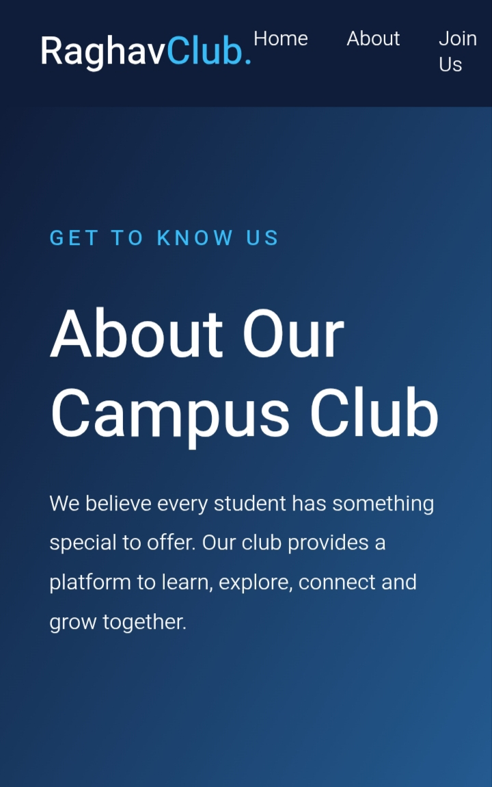
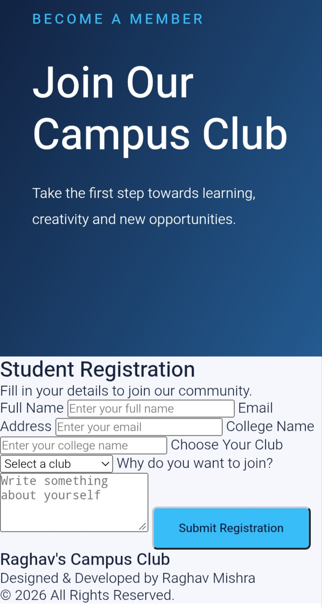

# Raghav's Campus Club 🎓

A modern and responsive College Club Website created using HTML and CSS.

## 👨‍💻 Developer

**Raghav Mishra**

## 🌐 Project Overview

Raghav's Campus Club is a student community website designed to help students explore their interests, develop new skills and connect with others.

## ✨ Features

- Modern and attractive homepage
- About Us page
- Student registration form
- Contact page
- Responsive navigation bar
- Mobile-friendly design
- Multiple club sections

## 🛠️ Technologies Used

- HTML5
- CSS3

## 📁 Project Structure

```text
Day04-College-Club-Site/
│
├── index.html
├── about.html
├── registration.html
├── contact.html
├── styles.css
└── README.md
```

## 🚀 How to Run

1. Download or clone this repository.
2. Open the project folder.
3. Open index.html in a browser.

## 🎯 Project Goal

To practice HTML and CSS by creating a modern college club website.

---

**Created with ❤️ by Raghav Mishra**

© 2026 All Rights Reserved.

## 📸 Website Screenshot


## 📸 Website Screenshot




## 📸 Website Screenshot


